# Практическое занятие №19. SEO и аналитика

Шаповалова Софья  
Группа: ПР-24.102  
Преподаватель: Зиберева А. А.

Это отчёт по методичке: файл `docs/audit/README.md`. Скриншоты лежат в `docs/audit/screenshots/`, сохранённые HTML-отчёты Lighthouse — в `docs/audit/reports/`. Цифры взяты только со скринов. Полные кадры входа, кабинета и панели в папку не кладу: там видна почта. Для входа вставлена обрезанная панель Lighthouse.

Сайт проверяла уже собранный, по адресу https://merchania.localhost. Это не режим разработки. В интернет проект не выкладывала, полевых данных по нему нет. Метрику и Google Analytics не подключала: это персональные данные, 152-ФЗ.

Замеры снимала в Яндекс Браузере, в панели была кнопка «Спросить Алису», окно не было чистым инкогнито.

## 1. Какие страницы проверяла и как

Открытые страницы есть в sitemap.xml, их проверяла со всеми четырьмя категориями. На закрытых SEO не включала. Кабинет, корзину, оформление и панель открывала после входа.

| Страница | Какая она | Как проверяла | Категории |
| --- | --- | --- | --- |
| / | открытая, есть в sitemap | 3 запуска | все четыре |
| /catalog | открытая, есть в sitemap | 3 запуска | все четыре |
| /support | открытая, есть в sitemap | 3 запуска | все четыре |
| /product/1 | открытая, есть в sitemap | 3 запуска | все четыре |
| /product/2 | открытая, тот же шаблон | 1 запуск | все четыре |
| /product/9 | открытая, тот же шаблон | 1 запуск | все четыре |
| /product/3 … /product/8 | открытые, есть в sitemap | отдельно не запускала | все четыре |
| /login | noindex | 3 запуска | без SEO |
| /register | noindex | 1 запуск | без SEO |
| /forgot-password | noindex | 1 запуск | без SEO |
| /account | закрыта в robots.txt, нужен вход | после входа, 1 запуск | без SEO |
| /cart | закрыта в robots.txt, нужен вход | после входа, 1 запуск | без SEO |
| /checkout | закрыта в robots.txt, нужен вход | после входа, 1 запуск | без SEO |
| /dashboard | закрыта в robots.txt, нужен вход художника | после входа, 1 запуск | без SEO |

Карточки 3–8 устроены как первая, но /product/1 сам прыгал от 71 до 99, поэтому один шаблон не гарантирует одну оценку.

## 2. Результаты Lighthouse

Режим Navigation, устройство Desktop. На открытых страницах четыре категории. Медиана — среднее по порядку, не среднее арифметическое. У главной 90, 100 и 100, медиана 100. У /product/1 99, 73 и 71, медиана 73.

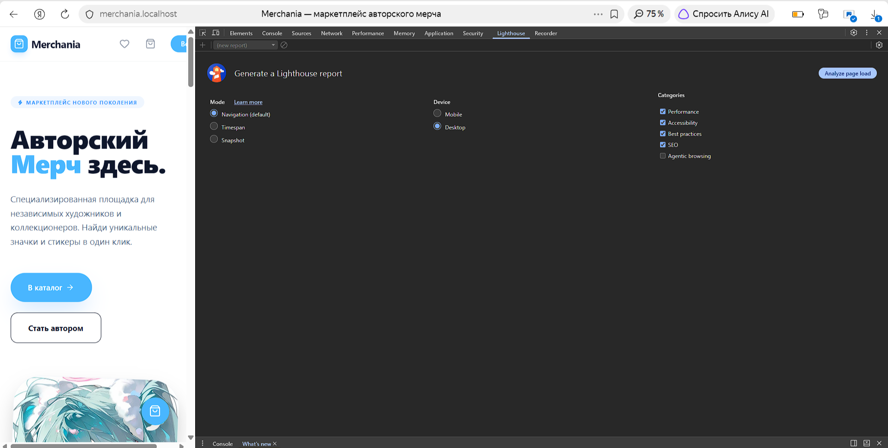

Скриншот настроек. Файл 2026-11-27_16-45-01.png

| Страница | Performance | Accessibility | Best Practices | SEO |
| --- | --- | --- | --- | --- |
| / | 90, 100, 100; медиана 100 | 81, 81, 81; медиана 81 | 100, 100, 100; медиана 100 | 100, 100, 100; медиана 100 |
| /catalog | 88, 88, 91; медиана 88 | 68, 68, 68; медиана 68 | 100, 100, 100; медиана 100 | 100, 100, 100; медиана 100 |
| /support | 100, 100, 100; медиана 100 | 87, 87, 87; медиана 87 | 100, 100, 100; медиана 100 | 100, 100, 100; медиана 100 |
| /product/1 | 99, 73, 71; медиана 73 | 78, 78, 78; медиана 78 | 100, 100, 100; медиана 100 | 100, 100, 100; медиана 100 |
| /product/2 | 75 | 78 | 100 | 100 |
| /product/9 | 72 | 78 | 100 | 100 |
| /login | 100, 100, 100; медиана 100 | 78, 78, 78; медиана 78 | 100, 100, 100; медиана 100 | не включала |
| /register | 100 | 87 | 100 | не включала |
| /forgot-password | 100 | 87 | 100 | не включала |
| /account | 100 | 86 | 100 | не включала |
| /cart | 78 | 78 | 100 | не включала |
| /checkout | 100 | 87 | 100 | не включала |
| /dashboard | 90 | 81 | 100 | не включала |

Метрики запуска, который совпал с медианой Performance:

| Страница | FCP | LCP | TBT | CLS | Speed Index |
| --- | --- | --- | --- | --- | --- |
| /, медиана 100 | 0,3 с | 0,5 с | 0 мс | 0 | 0,4 с |
| /catalog, медиана 88 | 0,4 с | 0,4 с | 0 мс | 0,248 | 0,4 с |
| /support, медиана 100 | 0,4 с | 0,4 с | 0 мс | 0 | 0,4 с |
| /product/1, медиана 73 | 0,4 с | 1,5 с | 0 мс | 0,454 | 1,6 с |

На главной первый запуск дал Speed Index 7,4 с и Performance 90. Два следующих дали 100 и Speed Index 0,4 с. На карточке товара один запуск был 99 без сдвига, два других 73 и 71 со сдвигом 0,454. Медиана 73. Один удачный запуск вывод не делает.

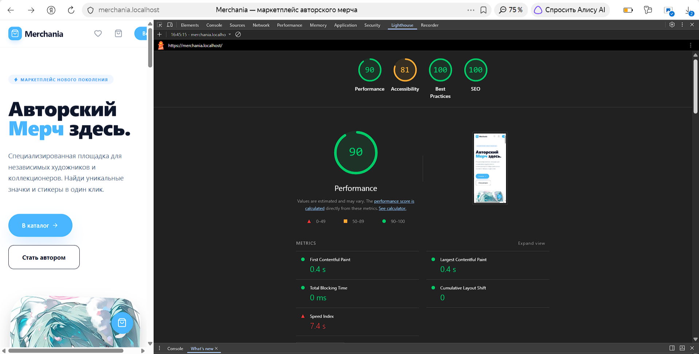

Главная, первый запуск, Performance 90. Файл 2026-11-27_16-46-50.png

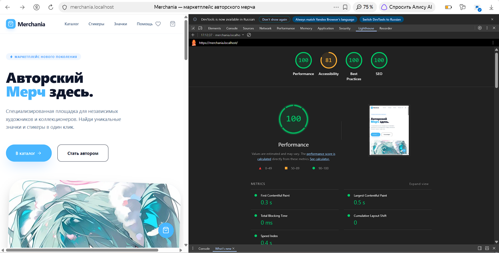

Главная, запуск с медианой 100. Файл 2026-11-27_17-12-53.png. Второй запуск на 100: 2026-11-27_17-12-17.png

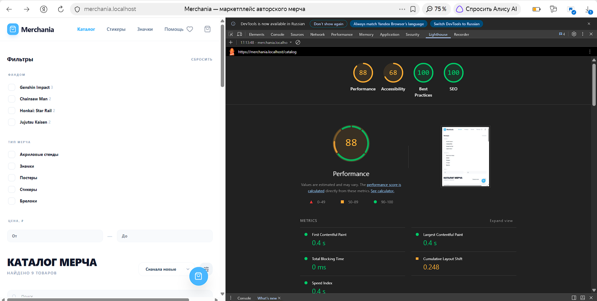

Каталог, запуск с медианой 88, Accessibility 68, CLS 0,248. Файл 2026-11-27_17-14-00.png. Другие запуски: 2026-11-27_16-48-07.png и 2026-11-27_17-14-41.png

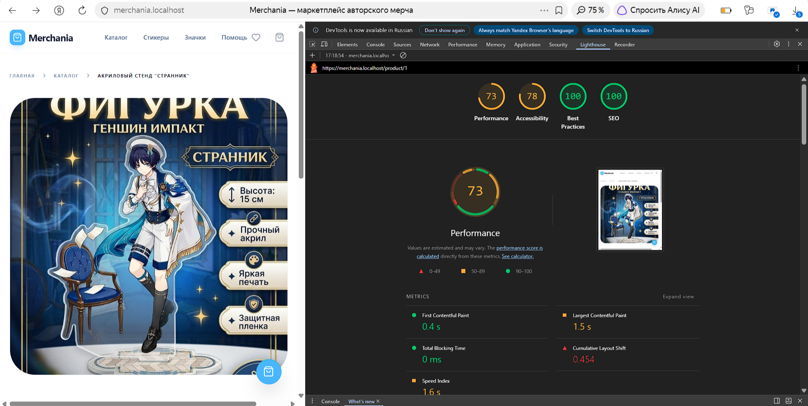

/product/1, запуск с медианой 73, CLS 0,454. Файл 2026-11-27_17-19-08.png. Запуск на 99: 2026-11-27_16-50-35.png. Запуск на 71: 2026-11-27_17-20-26.png

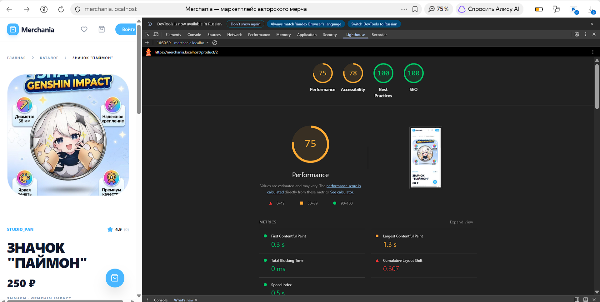

/product/2, CLS 0,607. Файл 2026-11-27_16-51-17.png. /product/9: 2026-11-27_16-51-50.png

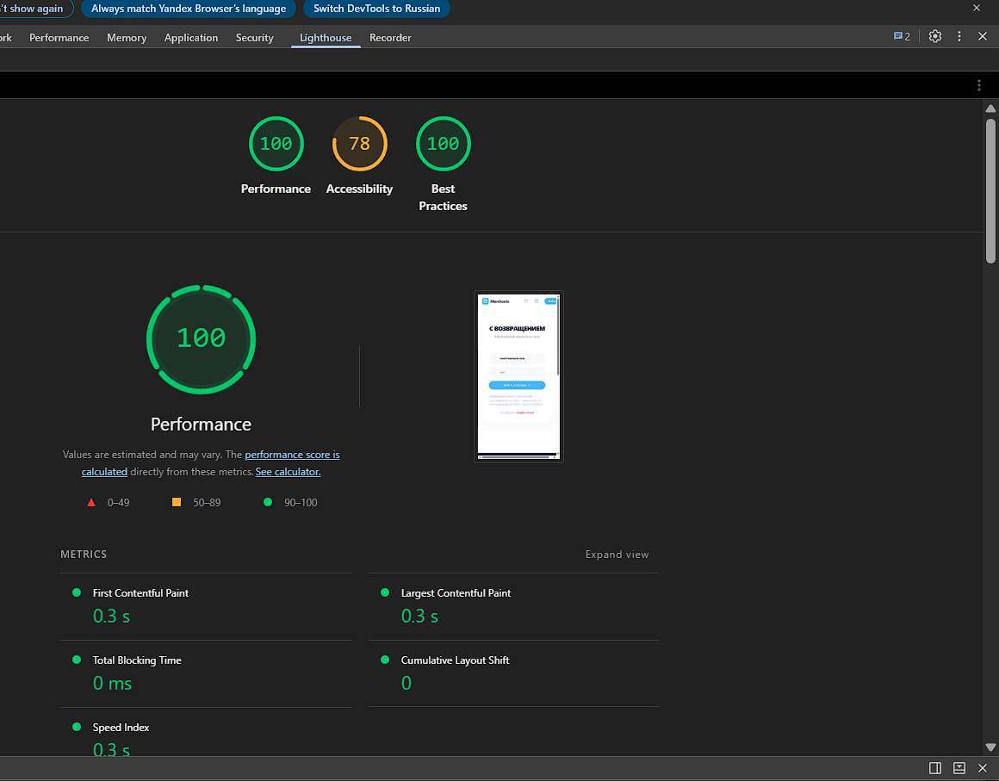

Вход, SEO не включала, Performance 100, Accessibility 78. Почта обрезана. В папке только этот кроп, полный кадр с почтой не лежит.

Поддержка, первый запуск: 2026-11-27_16-49-08.png. Корзина Lighthouse: 2026-11-27_16-55-38.png, Performance 78, CLS 0,607. Оформление: 2026-11-27_16-56-16.png. Кабинет 100 / 86 / 100 и панель 90 / 81 / 100 в полный кадр не кладу, там была почта.

## 3. Core Web Vitals

Живые метрики снимала на вкладке Performance, не в Lighthouse. Кнопку Record не нажимала. До клика INP был пустой. После плюса в корзине INP стал 16 мс.

Пороги: LCP хорошо до 2,5 с, от 2,5 до 4 с требует улучшения, больше 4 с плохо. INP хорошо до 200 мс. CLS хорошо до 0,1, от 0,1 до 0,25 требует улучшения, больше 0,25 плохо. Это пороги для полевых данных. У меня локальный сервер и один компьютер.

| Страница | LCP | Оценка | INP | Оценка | CLS | Оценка |
| --- | --- | --- | --- | --- | --- | --- |
| /cart, живые | 2,64 с | требует улучшения | 16 мс | хорошо | 0,32 | плохо |
| /, лабораторный медианный | 0,5 с | хорошо | не мерит | — | 0 | хорошо |
| /product/1, лабораторный медианный | 1,5 с | хорошо | не мерит | — | 0,454 | плохо |
| /catalog, лабораторный медианный | 0,4 с | хорошо | не мерит | — | 0,248 | требует улучшения |

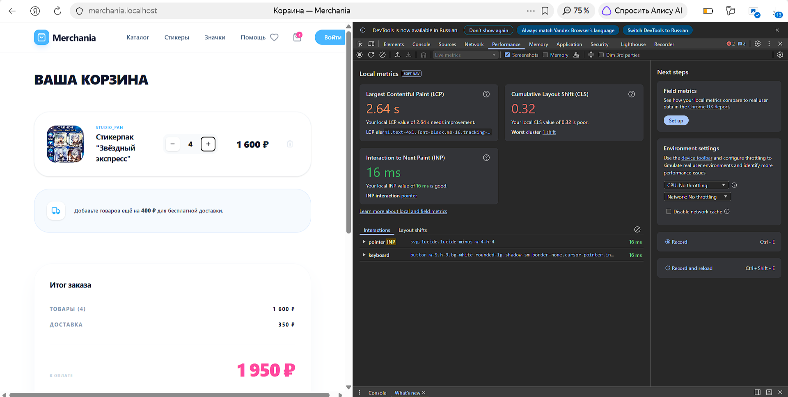

Живые метрики корзины и Interactions после плюса. Файл 2026-11-27_17-31-44.png. Кадр до клика: 2026-11-27_17-24-49.png

## 4. Ручные проверки

В исходном HTML главной есть lang="ru", title и description, canonical на https://example.com/. Блок root пустой. Содержимое страницы появляется только после JavaScript. На входе во вкладке Elements noindex нашёлся, 1 из 1: noindex, nofollow. В исходном HTML главной этой строки нет. Те же адреса закрыты и в robots.txt. На занятии 70–71 я закрывала их специально, запрет не снимала. /api/ остаётся закрытым.

robots.txt и sitemap.xml открываются как файлы, не как страница магазина. В карте главная, каталог, поддержка и товары 1–9. Эти адреса в robots.txt не закрыты. Sitemap в robots указан как https://example.com/sitemap.xml, потому что домена нет.

Tab на главной дошёл до кнопки «Войти», внизу браузера был адрес /login. На текстовых ссылках шапки рамка почти не видна. В режиме телефона, Samsung Galaxy S8+, 360×740, первая часть главной влезает, текст переносится.

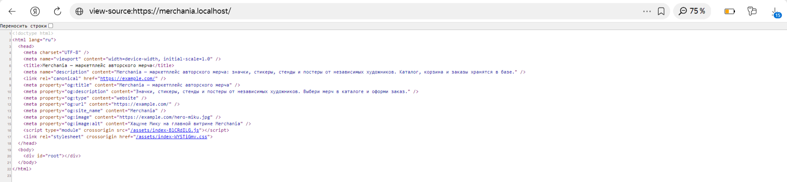

Исходный HTML главной. Файл 2026-11-27_17-32-12.png

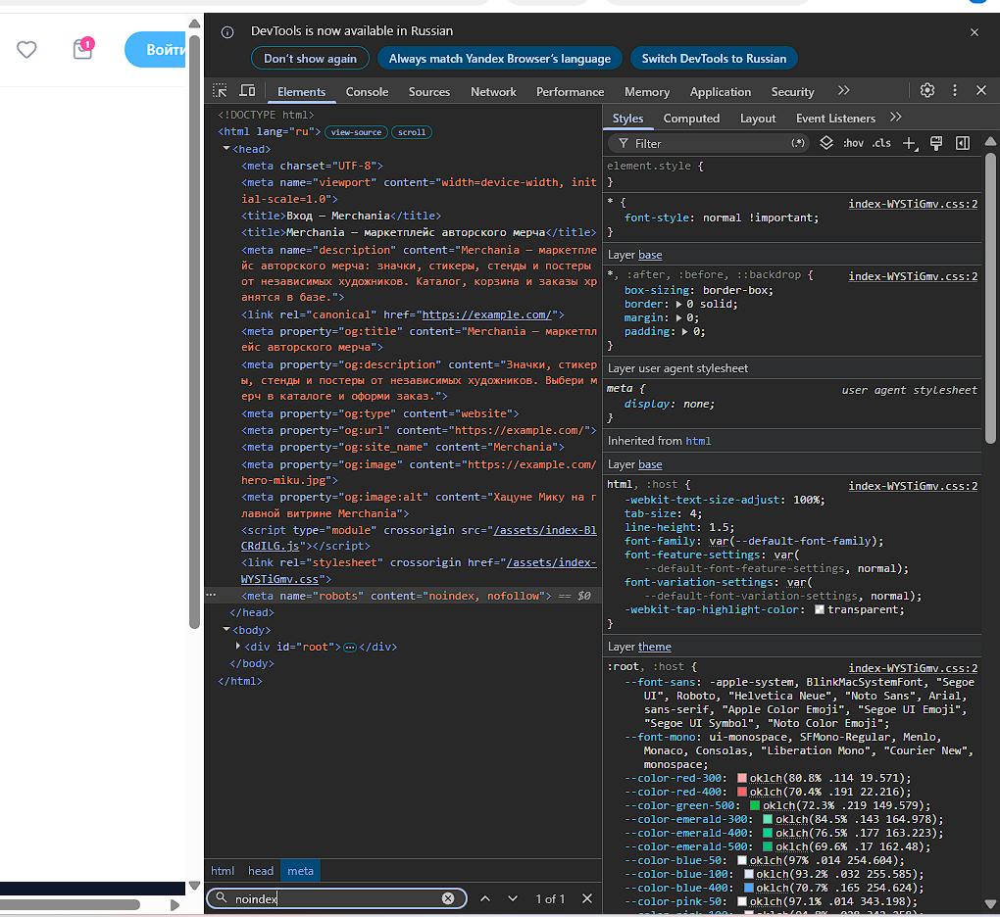

noindex на входе, Elements, почта обрезана. Исходный файл 2026-11-27_17-42-11.png

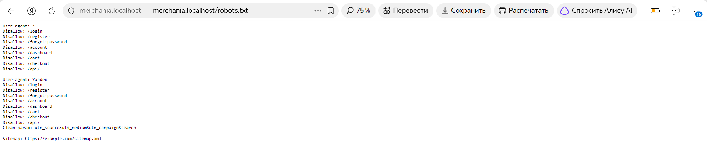

robots.txt. Файл 2026-11-27_17-32-39.png

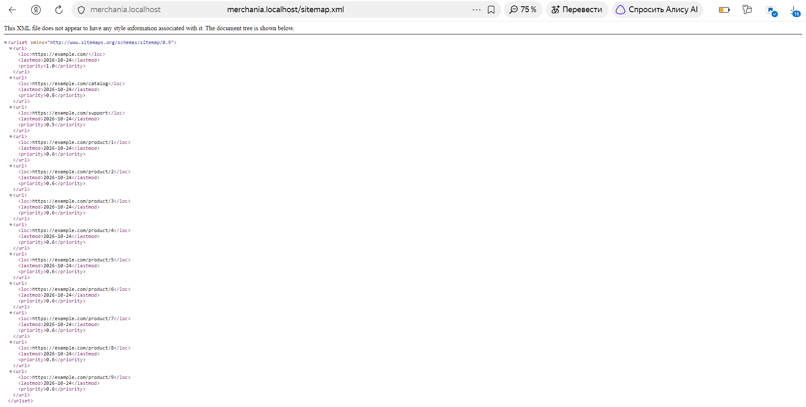

sitemap.xml. Файл 2026-11-27_17-33-08.png

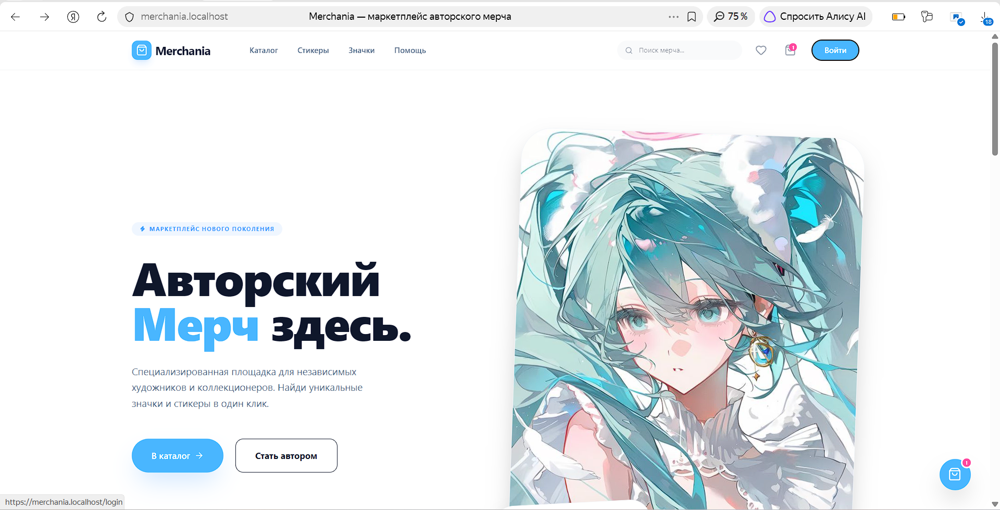

Tab на кнопке «Войти». Файл 2026-11-27_17-40-17.png

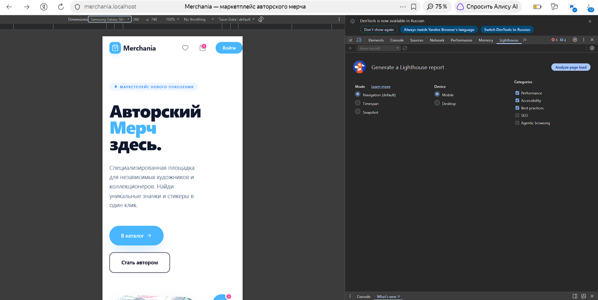

Главная на телефоне. Файл 2026-11-27_17-37-03.png

| Проверка | Страница | Результат |
| --- | --- | --- |
| lang | / | есть, ru |
| title в исходном HTML | / | один на все адреса |
| description | / | есть, одинаковый на всех адресах |
| Содержимое в исходном HTML | / | нет, root пустой |
| noindex после загрузки | /login | есть, 1 из 1 |
| noindex в исходном HTML | / | нет |
| robots.txt | корень | открывается, закрыты вход, кабинет, корзина, панель и /api/ |
| sitemap.xml | корень | открывается, открытые адреса не закрыты в robots.txt |
| Клавиатура | / | фокус доходит до «Войти», на текстовых ссылках рамка почти не видна |
| Телефон | / | Galaxy S8+, первая часть главной влезает |

## 5. Сравнение с занятиями 70–71

Тогда смотрела только SEO, на http://localhost:8080. До правок было 83: не было description, robots.txt был недействителен. Отдельного кадра «после» с баллом в папке нет, вторую цифру того занятия не выдумываю. Сейчас на открытых страницах SEO 100.

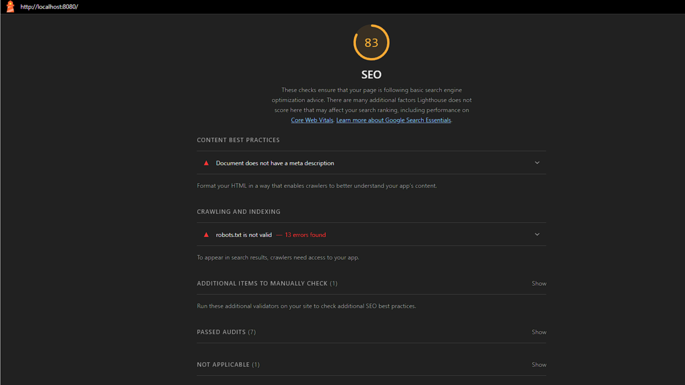

SEO до правок, 83 балла. Файл docs/seo/before.png

## 6. Найденные проблемы и приоритеты

Красные пункты Lighthouse по именам не раскрывала, поэтому причину Accessibility не назначаю наугад.

| Приоритет | Проблема | Страница | Влияние | Сложность | Как исправить |
| --- | --- | --- | --- | --- | --- |
| 1 | Сдвиг макета: CLS 0,454 на /product/1, 0,607 на /product/2, /product/9 и в лабораторной корзине, живой CLS корзины 0,32 | карточки и /cart | высокое | средняя | вместо строки «Загружаю…» оставить блок той же сетки. Сделано, повторный замер в разделе 9 |
| 2 | Accessibility ниже 90: каталог 68, карточки и вход 78, главная 81 | /catalog, /product/1, /login, / | высокое | средняя | править то, что названо в раскрытом пункте. По кружкам причину не пишу |
| 3 | В исходном HTML пустой root, один title на все адреса | открытые | высокое | высокая | серверный рендер, в этой работе не делаю |
| 4 | Живой LCP корзины 2,64 с | /cart | среднее | средняя | смотреть вместе со сдвигом |
| 5 | noindex и запрет в robots.txt одновременно | закрытые страницы | среднее | низкая | оставила как на занятии 70–71 |
| 6 | Рамка фокуса на текстовых ссылках почти не видна | / | среднее | низкая | вернуть видимый фокус |
| 7 | canonical и sitemap указывают на example.com | открытые | низкое | низкая | менять только в день публикации |

## 7. Что осталось неисправленным и почему

Сдвиг на карточке и в корзине я поправила и пересняла, цифры в разделе 9. Остальное не трогала. Серверный рендер не делала: это переписывание фронтенда. Пункты Accessibility по именам не исправляла, красный список не раскрыт, на повторном запуске карточки Accessibility осталась 78. Запрет в robots.txt не снимала, так было на занятии 70–71, /api/ должен остаться закрытым. example.com не меняла, домена нет. Аналитику не подключала, 152-ФЗ. Полную мобильную вёрстку каталога не делаю: на главной в режиме телефона первая часть страницы уже влезает. Кадра after.png с занятия 70–71 нет, вторую цифру того занятия не выдумываю.

## 8. Сравнение с сайтом-аналогом

Аналог один: https://pro.bxb.delivery/. Это доставка Boxberry, не магазин мерча. На моём сайте доставка через Boxberry, нескольких конкурентов задание не требует. Для таблицы беру вкладку «Мобильные устройства». Свои Desktop-баллы с их мобильной проверкой напрямую не равняю: у них замедление сети и процессора, у меня локальный сервер.

| Показатель | Мой проект, Desktop | Аналог, полевые, мобильные | Аналог, Lighthouse, мобильные |
| --- | --- | --- | --- |
| LCP | 0,5 с на главной | 2,7 с, требует улучшения | 7,1 с |
| INP | 16 мс, живые метрики корзины | 126 мс, хорошо | — |
| CLS | 0 на главной; 0,454 на товаре; 0,32 живьём в корзине | 0, хорошо | 0 |
| Performance | 100, медиана главной | — | 69 |
| Accessibility | 81, медиана главной | — | 80 |
| Best Practices | 100 | — | 96 |
| SEO | 100 | — | 100 |

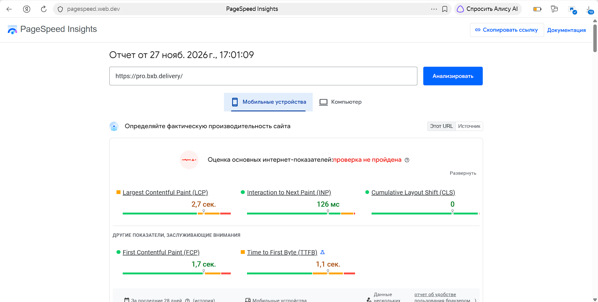

Полевые данные аналога, мобильные. Проверка не пройдена. Файл 2026-11-27_17-26-29.png

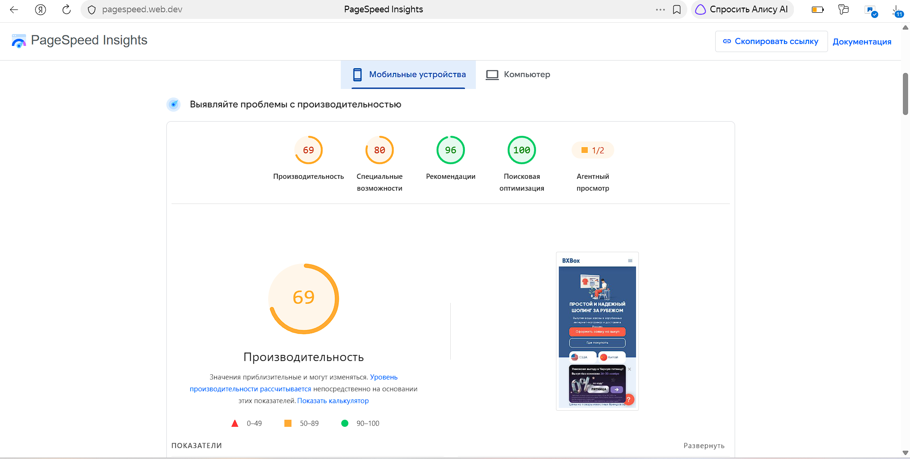

Лабораторные оценки аналога, мобильные: 69, 80, 96, 100. Файл 2026-11-27_17-26-41.png

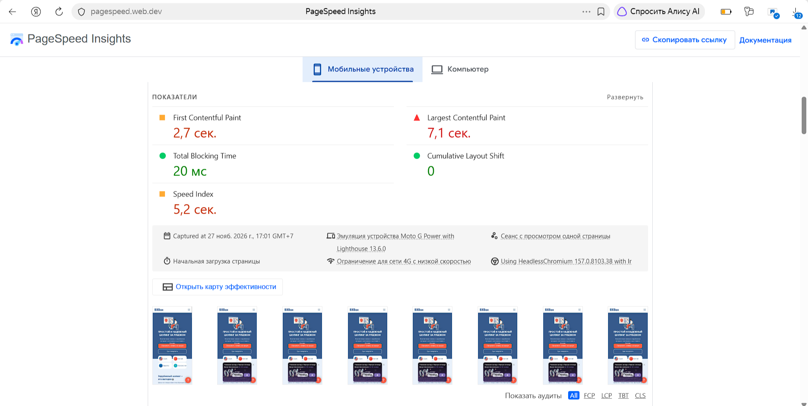

Лабораторные метрики аналога: LCP 7,1 с, CLS 0, Speed Index 5,2 с. Файл 2026-11-27_17-26-57.png

У моего сайта полевых данных нет. У Boxberry они есть, и проверка всё равно не пройдена из-за LCP 2,7 с, хотя INP и CLS хорошие. Их 69 баллов и мой 100 нельзя ставить как соревнование: у них телефон и медленный 4G, у меня Desktop локально. Мой живой LCP корзины 2,64 с ближе к их полевым 2,7 с, чем мой лабораторный 0,5 с. По сдвигу до правки они были лучше: CLS 0. У меня на карточке было 0,454, в живой корзине 0,32. После правки повторный запуск карточки дал CLS 0,006, живые метрики корзины — 0,00. SEO у обоих 100, но у меня в исходном HTML страница пустая, Lighthouse этого не видит.

## 9. Было — стало

Повторный замер сняла 27 ноября 2026 года на том же адресе, https://merchania.localhost. На карточке это один запуск Lighthouse, не новая медиана из трёх. В корзине это живые метрики после щелчка по плюсу. Плюс и минус здесь одно и то же: панель записала нажатие на кнопку количества.

| Что | Было | Стало |
| --- | --- | --- |
| CLS на /product/1 | 0,454, плохо, медианный запуск | 0,006, хорошо, один запуск |
| Performance /product/1 | 73, медиана трёх запусков | 87, один запуск |
| CLS корзины, живые метрики | 0,32, плохо | 0,00, хорошо |
| LCP корзины, живые метрики | 2,64 с, требует улучшения | 0,15 с, хорошо |
| INP корзины, живые метрики | 16 мс, хорошо | 0 мс, хорошо, щелчок по плюсу |

Кружок Performance не стал зелёным: Speed Index на этом кадре 3,3 с. LCP карточки остался 1,5 с. Accessibility осталась 78. Со старыми тремя запусками этот один запуск не усредняю.

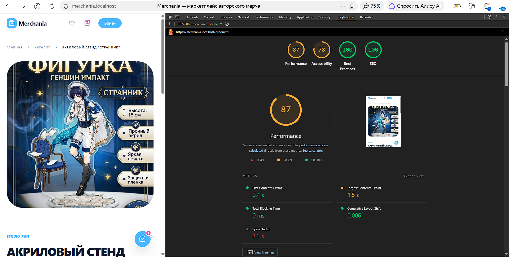

Повторный запуск /product/1. Performance 87, CLS 0,006. Один запуск, не медиана. Файл 2026-11-27_18-52-31.png

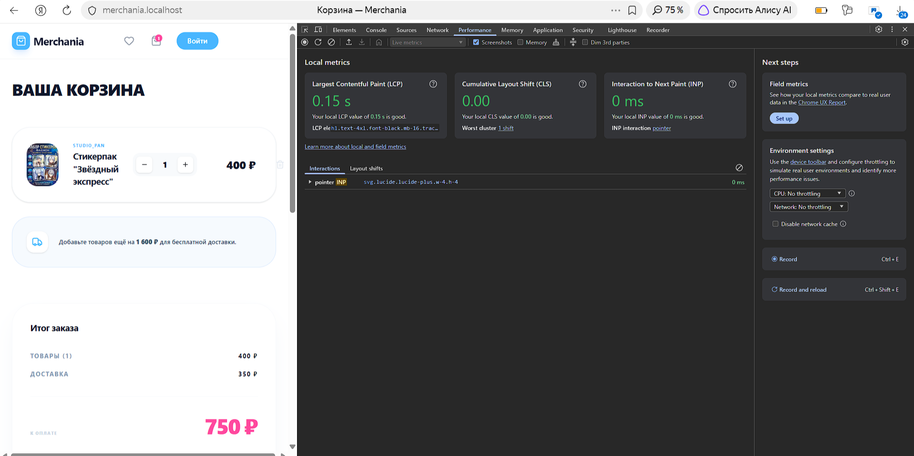

Живые метрики корзины после правки. LCP 0,15 с, CLS 0,00, INP 0 мс, щелчок по плюсу. Файл 2026-11-27_18-53-47.png
